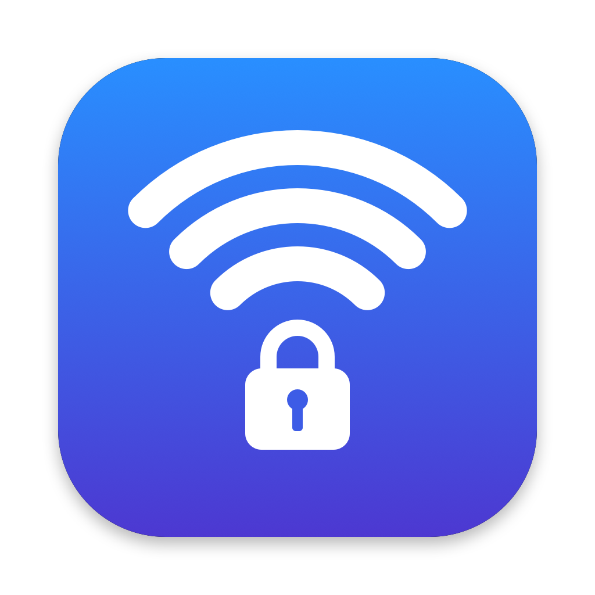

<p align="center">
  
</p>

<h1 align="center">BSSIDLock</h1>

<p align="center">
  Keep your computer on the Wi-Fi access point <em>you</em> choose, not the one it roams to.<br>
  Native apps for <strong>macOS</strong> and <strong>Windows</strong>. Free and open source.
</p>

<p align="center">
  <a href="#install"><b>Install</b></a> ·
  <a href="#first-run">First run</a> ·
  <a href="#is-it-safe">Is it safe?</a> ·
  <a href="#build-from-source">Build from source</a>
</p>

---

When one network name (SSID) is served by several access points, as in mesh systems, offices or homes with extenders, your computer decides which one to join. It often picks a far, slow one, or keeps hopping between them. Neither macOS nor Windows lets you pin a connection to a specific access point (BSSID).

BSSIDLock does:

- **See every access point** on your network, with signal quality, band and channel.
- **Lock to one access point**, or star a few **favorites** and let BSSIDLock use the best one by your priority order.
- **Name your access points** ("Living room", "Office") instead of memorizing addresses.
- **Stays locked.** It checks every few seconds and switches back if the system roams away.
- **Only touches the network you choose.** On any other Wi-Fi it does nothing.
- **Lives in the menu bar (macOS) or notification area (Windows).** Switch the lock target or turn the lock off from there.
- **Start at login**, quietly in the background.

## Install

One command, no certificates, no security warnings. It installs for your user only; no administrator password is needed.

**macOS** (13 Ventura or later, Apple silicon or Intel). Paste into Terminal:

```bash
curl -fsSL https://raw.githubusercontent.com/b3hz4d/bssid-lock/main/install.sh | bash
```

**Windows** (10 version 1903+ or 11). Paste into PowerShell:

```powershell
irm https://raw.githubusercontent.com/b3hz4d/bssid-lock/main/install.ps1 | iex
```

The installer downloads the latest release, checks it against the release's SHA-256 checksums, installs it (to `/Applications`, or `%LOCALAPPDATA%\Programs\BSSIDLock` with a Start menu shortcut on Windows) and opens it. Run the same command again to update.

<details>
<summary>Other ways to install, and uninstalling</summary>

- **Build it yourself on a Mac:** `curl -fsSL https://raw.githubusercontent.com/b3hz4d/bssid-lock/main/install.sh | bash -s -- --source`. This compiles the app from source on your Mac in under a minute, and needs Apple's free Command Line Tools.
- **Manual download:** get `BSSIDLock-macOS.zip` or `BSSIDLock.exe` from [Releases](https://github.com/b3hz4d/bssid-lock/releases/latest). Files downloaded with a browser show an "unknown developer" warning the first time.
  - **macOS:** open the app, then go to System Settings → Privacy & Security → **Open Anyway**.
  - **Windows:** **More info** → **Run anyway**.
- **Uninstall on macOS:** `curl -fsSL https://raw.githubusercontent.com/b3hz4d/bssid-lock/main/install.sh | bash -s -- --uninstall`
- **Uninstall on Windows:** `& ([scriptblock]::Create((irm https://raw.githubusercontent.com/b3hz4d/bssid-lock/main/install.ps1))) -Uninstall`

</details>

## First run

1. **Allow location access.** Both macOS and Windows treat access point addresses as location data and hide them from apps without location permission. BSSIDLock never reads, stores or sends your actual location.
   - **macOS:** click **Allow** when asked. If you missed it, turn on BSSIDLock in System Settings → Privacy & Security → Location Services.
   - **Windows 11:** turn on **Location services** and **Let desktop apps access your location** in Settings → Privacy & security → Location. BSSIDLock shows a button that takes you there.
2. **Choose your network.** If you're connected to it, BSSIDLock picks it up automatically. Otherwise choose it from the list.
3. **Pick access points.** All access points on your network are listed with their signal strength.
   - **Lock** sticks to just that access point.
   - **★ (favorite)** marks the access points you're happy to use. Set **Lock to** to **Any favorite**, and BSSIDLock accepts any of them and prefers the top of the list. Drag (macOS) or use ↑/↓ (Windows) to reorder.
   - **Rename** gives an access point a friendly name. On macOS, right-click it; on Windows, press F2.

Leave BSSIDLock running. Closing the window keeps it working from the menu bar or notification area.

## Is it safe?

Yes, and you can check that yourself:

- **The code is open.** Both apps are small and readable: [`macos/Sources`](macos/Sources) and [`windows/BSSIDLock`](windows/BSSIDLock).
- **Release files are built by GitHub, not on someone's laptop.** The [Release workflow](.github/workflows/release.yml) builds both apps from the tagged source. Each release lists SHA-256 checksums and carries a signed [build provenance attestation](https://docs.github.com/actions/security-for-github-actions/using-artifact-attestations). To prove a file came from this repository, run:
  ```
  gh attestation verify BSSIDLock.exe -R b3hz4d/bssid-lock
  ```
- **It does very little.**
  - No network access, telemetry or updater.
  - No administrator rights, drivers or background services.
  - It only reads Wi-Fi status and asks the system to join an access point you picked.
  - Settings stay on your computer. The optional macOS Wi-Fi password goes in your Keychain.
- **The Windows app is plain .NET Framework,** with no packer, bundler or obfuscation. Antivirus engines can read exactly what it does.

**Why there's no "unknown developer" warning with the installer:** macOS Gatekeeper and Windows SmartScreen only check files that a web browser marked as "downloaded from the internet". Those checks exist to catch apps that aren't signed with a paid code-signing certificate. Files fetched by `curl` or PowerShell, and apps you build yourself, don't carry that mark. Windows Defender and macOS XProtect still scan the app as usual. Either way, you're trusting this repository, so the installers are short and readable: [install.sh](install.sh) and [install.ps1](install.ps1). Read them first if you like, or build from source.

## Build from source

```bash
git clone https://github.com/b3hz4d/bssid-lock.git
cd bssid-lock
```

**macOS app.** Needs the Xcode Command Line Tools (`xcode-select --install`):
```bash
./macos/build.sh                 # → macos/build/BSSIDLock.app (universal)
open macos/build/BSSIDLock.app
```

**Windows app.** Needs the [.NET SDK](https://dot.net) 8 or later, and builds on Windows, macOS or Linux:
```bash
./windows/build.sh               # macOS / Linux → windows/out/BSSIDLock.exe
.\windows\build.ps1              # Windows (PowerShell)
```

## How it works

BSSIDLock listens for the system's Wi-Fi change events: connected, roamed and disconnected. When you're on your chosen network but not on an allowed access point, it asks the system to join the specific access point you picked:

- **macOS:** CoreWLAN. It watches `CWEventType.bssidDidChange` and friends, then calls `CWInterface.associate(to:password:)` with the scanned network for that BSSID.
- **Windows:** Native Wi-Fi API. It registers with `WlanRegisterNotification`, then calls `WlanConnect` with your saved Wi-Fi profile and a one-entry desired-BSSID list.

**Speed and battery:**
- It reacts within about 1.5 seconds of a roam, without constant polling. A light check every few seconds (10 by default) is only a safety net.
- If the access point was seen in a scan during the last 30 seconds, it switches right away without scanning again.
- If none of your choices is in range, it waits 60 seconds before trying again, so it doesn't keep scanning and slowing your connection.
- The apps are small: about 1.2 MB on macOS (universal) and 150 KB on Windows.

## Limitations

- **The system may roam briefly** before BSSIDLock moves you back, usually within a couple of seconds.
- **Location permission is required** on macOS and on Windows 11 24H2 and later. Without it, access points can't be told apart.
- **Windows needs the network saved.** Connect to it normally once first. BSSIDLock reuses the saved profile and never asks for the password.
- **Some Wi-Fi drivers ignore the access point request.** Check the Activity log if switching doesn't stick.
- **Enterprise (802.1X/EAP) networks are untested.**

## Troubleshooting

| Symptom | Fix |
| --- | --- |
| "Location access needed" | Grant location access; see [First run](#first-run). On macOS you can also run `tccutil reset Location io.github.b3hz4d.bssidlock` and relaunch. |
| macOS: no permission prompt | Open the app from Finder or with `open`, not by running the binary inside the bundle. |
| "Couldn't switch" | Check that the access point is in range. On macOS, save the Wi-Fi password in Settings. On Windows, make sure you've connected to the network once. |
| Status says "Idle on …" | You're on a different network than the one chosen. That's intentional. |
| Windows: app "disappears" when closed | It's still running in the notification area (tray). Right-click its icon → Exit to quit. |

## Project layout

```
install.sh / install.ps1 One-line installers for macOS / Windows
assets/                  Shared icon (icon-1024.png) and the scripts that draw it / build the .ico
macos/                   macOS app: SwiftUI sources, Info.plist, build.sh, notarize.sh
windows/                 Windows app: WinForms on .NET Framework 4.8, build.sh / build.ps1
docs/SIGNING.md          How releases get signed (for maintainers)
.github/workflows/       CI builds and the release pipeline
```

## Roadmap

- [x] macOS app
- [x] Windows app
- [x] One-line installers (no certificates needed)
- [ ] `winget` and Scoop packages
- [ ] Optional signed builds for manual downloads
- [ ] Separate favorites for each network
- [ ] Linux (NetworkManager already supports `bssid` per connection; a tray app could wrap it)

## Related projects

- [`airport-bssid`](https://github.com/qpSHiNqp/airport-bssid) ([fork](https://github.com/braineo/airport-bssid)) is a macOS command-line tool that joins a specific BSSID once.
- [WifiInfoView](https://www.nirsoft.net/utils/wifi_information_view.html) is a Windows freeware Wi-Fi scanner that can connect to a chosen access point.

BSSIDLock adds a friendly GUI on both platforms and keeps the lock in place.

## Contributing

Issues and pull requests are welcome. Both apps rebuild in seconds with the scripts above. Please describe your OS version and Wi-Fi hardware in bug reports; drivers matter here.

## License

[MIT](LICENSE)
